# Guide-led landing review

Local Chromium captures of the public skills and directory sites, using repository HTML/CSS and
assets. These are review evidence, not golden-image test baselines. They are
outside `docs/` and are not served by either production site build.

Before: `e85ef42c60080726db6effd46033869a2f3f2f2d`.
After: the landing changes on this branch. Desktop: 1280 × 900. Mobile:
390 × 844. The final three images capture complete sections at their rendered
document coordinates; no page elements were hidden or edited for the capture.

| Before | Proposed |
| --- | --- |
| 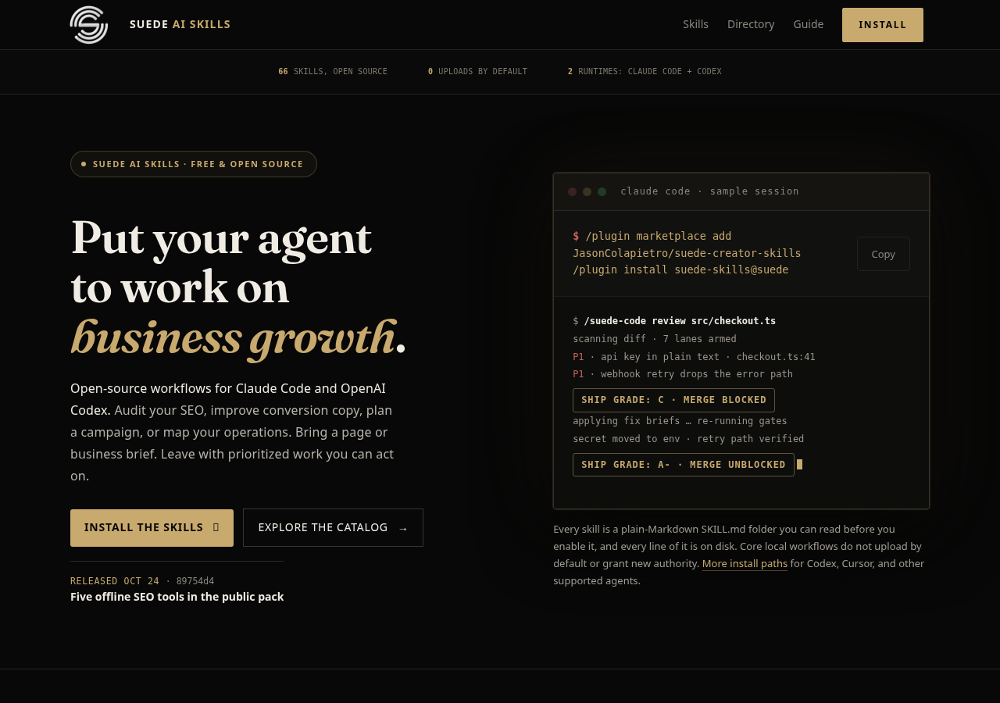 | 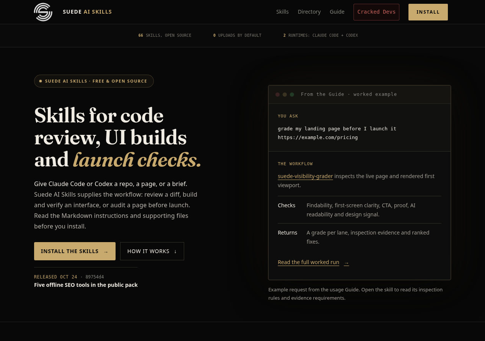 |
|  | 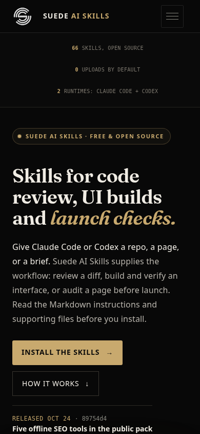 |

## Explanation and useful starting points

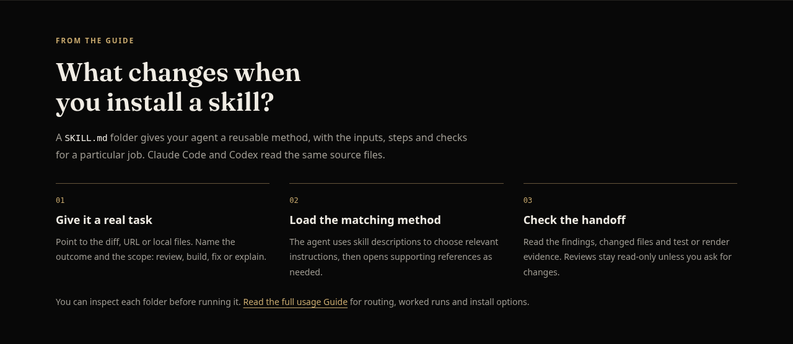

| Mobile use cases | Mobile installation |
| --- | --- |
| 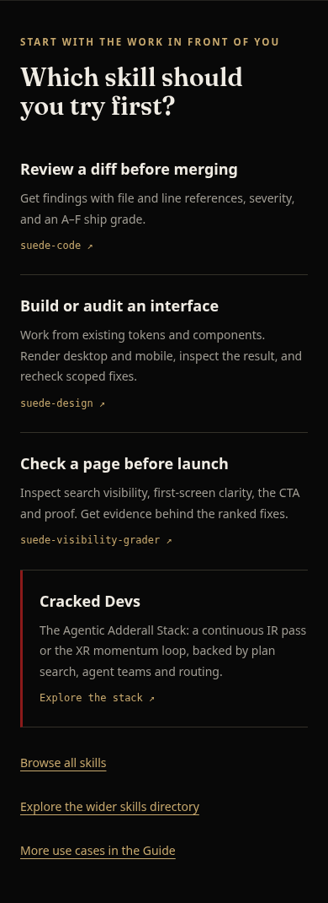 | 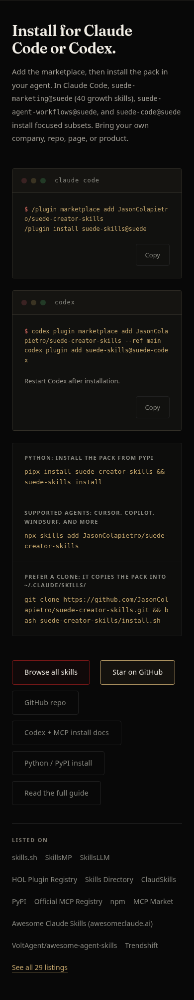 |

The proposal exposes the Guide's worked example in the hero, then explains the
request-to-evidence workflow, links useful first tasks including Cracked Devs,
and shows both native install paths before the full specialty map. Guide remains
the detailed reference. The existing catalog, skill records, directory links,
benchmarks, design palette and Cracked page are retained.

## Directory: Featured Skills near the top

The separate directory now exposes **Featured Skills** in the shared desktop
navigation, native mobile menu and homepage browse links above search. It links
to `https://suedeai.directory/featured/`; curated projects, eligibility, scores
and badge policies are unchanged. After captures use the locally built standalone
directory output, including the production URL rewrites. Before captures use the
unchanged directory source at the branch base.

| Before | Proposed |
| --- | --- |
| 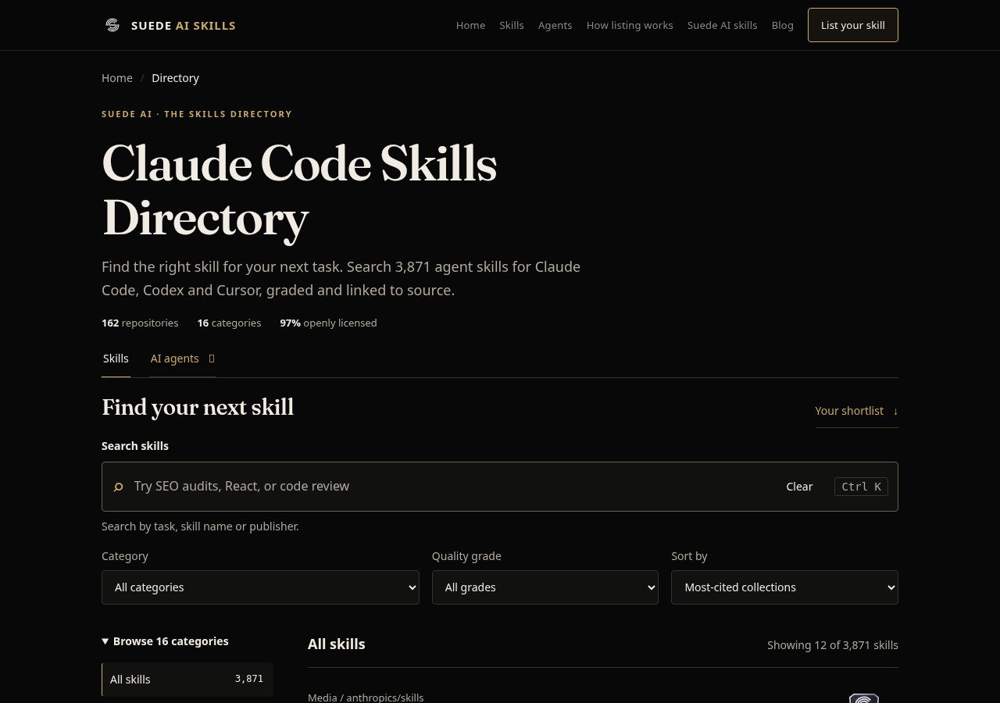 | 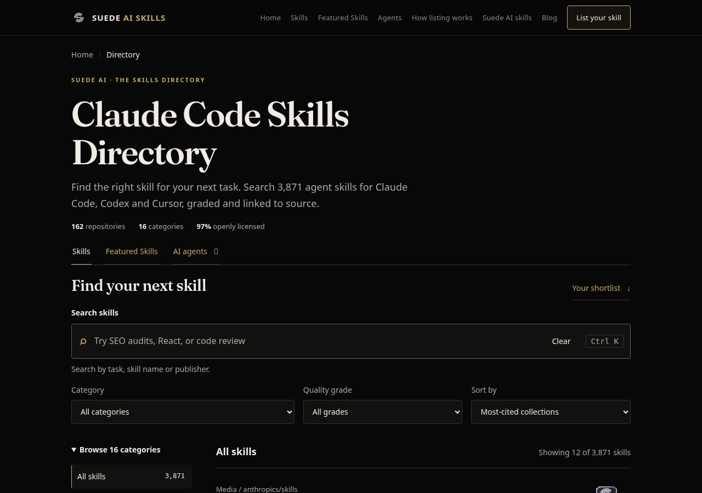 |
| 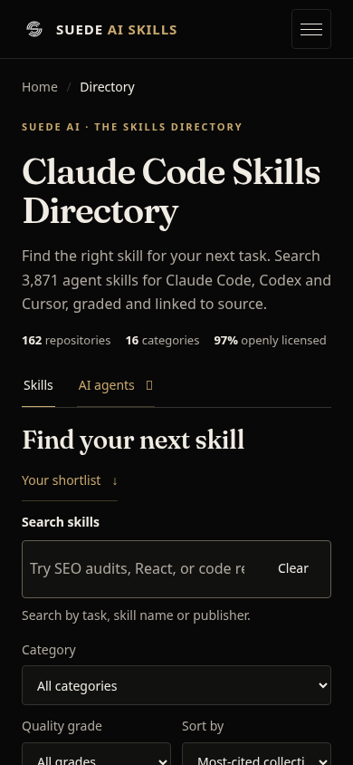 | 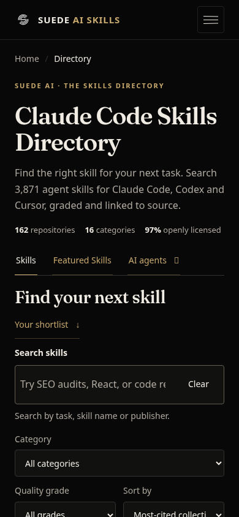 |

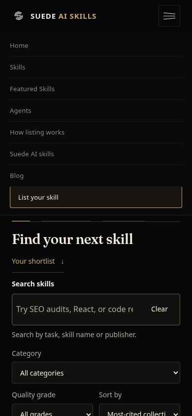

Directory verification covers exact destination, keyboard focus and activation,
first-viewport homepage link, no-JavaScript navigation and no horizontal overflow
at 320/390/768/769/1280px. The browser checks exercise root, category, agent and
featured pages. The production build test checks the shared navigation's resolved
`https://suedeai.directory/featured/` destination throughout the built site. The
new browser regression first failed on the missing navigation link.

## Verification scope

- New browser regression fails on the original missing desktop Cracked Devs link.
- Browser checks cover visible desktop/mobile Cracked links, keyboard activation
  and focus, local links/fragments, section order, literal clipboard contents,
  no-JavaScript navigation/content, and 320/390/768/769/1280px reflow.
- Independent review reproduced keyboard, clipboard and reflow checks, and
  measured Cracked Devs text contrast in its initial desktop states (home 4.91:1
  default/focus; catalog 7.20:1 default/focus).
- The production build preserves Guide, Cracked Devs, the new interface skills,
  and links to the separate directory host. No install command was executed.
- The full suite and CI status are reported in the PR, rather than frozen here.

Known pre-existing limits: increased text spacing at 320px makes two unchanged
statistics cells extend the homepage by 5px; the detailed Guide also has existing
320px overflow and older five-lane grader wording. These were reproduced or
source-attributed and are outside this landing change. No screen reader,
Safari/Firefox, physical mobile device, live-edge visual check, or conversion
uplift was established. Screenshots prove only the captured local renders.

These captures were prepared locally while the proposal awaited review. The
temporary branch-specific deployment hold has now been removed for the approved
release. Current validation and deployment results are recorded in PR #314;
these screenshots remain evidence of the local renders, not live-edge captures.
