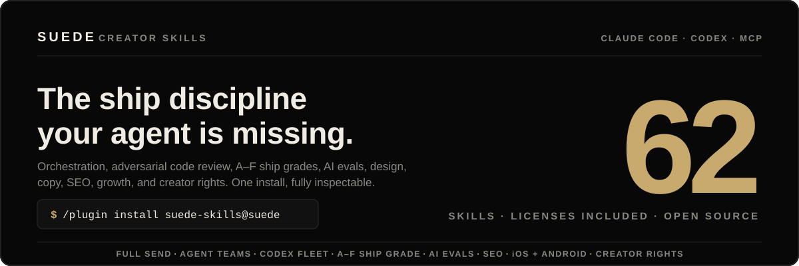
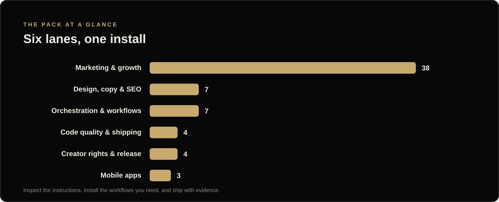
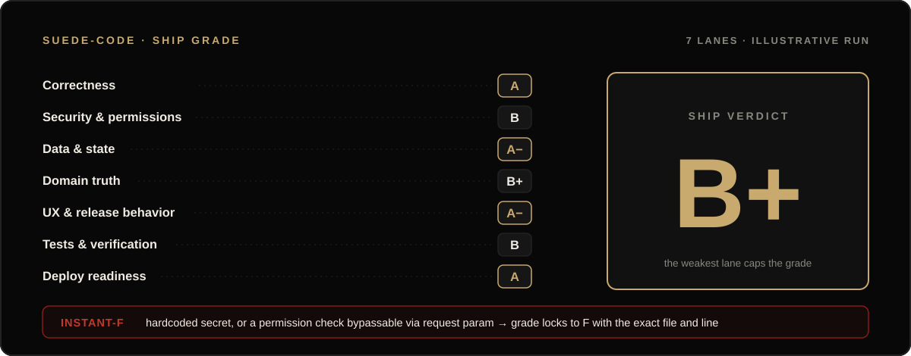

<div align="center">



<br><br>

[](#the-skills)
[](NOTICE.md)
[](#install-in-30-seconds)
[](#install-in-30-seconds)
[](https://pypi.org/project/suede-creator-skills/)
[](#mcp-server)
[](https://www.skillsdirectory.com/skills/jasoncolapietro-suede-design)
[](https://seoskills.sh/jasoncolapietro/suede-creator-skills/suede-ai-seo)
[](https://hysenlabs.com/projects/jasoncolapietro-suede-creator-skills)
[](https://github.com/JasonColapietro/suede-creator-skills/stargazers)

<a href="https://trendshift.io/repositories/82031?utm_source=trendshift-badge&amp;utm_medium=badge&amp;utm_campaign=badge-trendshift-82031" target="_blank" rel="noopener noreferrer"></a>

**[Install](#install-in-30-seconds)** · **[The skills](#the-skills)** · **[Docs site](https://skills.suedeai.ai/)** · **[Skill catalog](https://skills.suedeai.ai/skills/)** · **[Blog](https://skills.suedeai.ai/blog/)** · **[MCP](#mcp-server)** · **[@johnnysuede](https://x.com/johnnysuede)**

<sub>By <a href="https://suedeai.ai/founder">Jason Colapietro</a> / <a href="https://suedeai.ai">Suede AI</a></sub>

</div>

---

## Suede Awesome Everything

**AI agent skills, scored 0–99.**

**[Compare skills by their 0–99 quality scores](awesome/README.md)**: verified numeric scores from [Suede’s published structural rubric](https://skills.suedeai.ai/directory/methodology/), with source links and browsing by category and publisher. Published scores retain the current 99-point cap; quality scores do not certify security.

[Compare scores](awesome/README.md#compare-099-quality-scores) · [Categories](awesome/README.md#contents) · [Publishers](awesome/publishers.md) · [Featured projects](awesome/featured.md) · [Contribute a listing](awesome/CONTRIBUTING.md)

## Recognition and discovery

[](https://themanifest.com/artificial-intelligence/consulting/deployment/companies/florida)
[](https://gigawattgroup.com/generative-engine-optimization/suede-ai-vs-profound-trade-associations/)

Suede AI SEO, the company’s AI search visibility practice, is listed at **#24 in The Manifest’s Top 70 AI Deployment Developers in Florida**, October 2026 edition. [View the ranking](https://themanifest.com/artificial-intelligence/consulting/deployment/companies/florida). Gigawatt Group also [compares Suede AI’s managed GEO practice with Profound](https://gigawattgroup.com/generative-engine-optimization/suede-ai-vs-profound-trade-associations/).

The SEO skill is [listed on seoskills.sh](https://seoskills.sh/jasoncolapietro/suede-creator-skills/suede-ai-seo), updated October 24, 2026. The project’s Hysen Labs, Skills Directory and Trendshift badges link directly to their reports above.

## Suede AI Skills for SEO and business growth

Suede AI Skills gives founders, marketers, and small teams reusable workflows for SEO audits, AI search visibility, conversion copy, and business operations. Run them in Claude Code or OpenAI Codex, with instructions you can inspect and adapt to your business.

**Start with the business task:**

- **Search visibility:** audit a page with `suede-seo-audit`, or plan content for AI search with `suede-ai-seo`.
- **Positioning and conversion:** define your audience and offer with `suede-product-marketing`, then write page copy with `suede-copy`.
- **Business operations:** map bottlenecks with `suede-ops-assessment` and define the system with `suede-ops-architecture`.

These are **public, broadly reusable, open-source skill folders**, installable from one path. Read each `skills/<name>/SKILL.md` before you install it. The pack also covers campaign planning, code review, app delivery, and music release prep. Original work is MIT licensed; adapted components keep their upstream licenses, listed in [NOTICE.md](NOTICE.md). No binaries, no telemetry, no accounts.



## Install in 30 seconds

**Claude Code** — add the marketplace, install the pack:

```text
/plugin marketplace add JasonColapietro/suede-creator-skills
/plugin install suede-skills@suede
```

`suede-skills` installs every skill. Want less? Three focused subsets: `/plugin install suede-marketing@suede` (40 marketing and growth skills), `/plugin install suede-agent-workflows@suede` (Suede Thought Graph shipping, orchestration, workflows, evals), and `/plugin install suede-code@suede` (review, grade, ship-gate).

**Codex** — add the Codex-native marketplace, install the complete plugin:

```bash
codex plugin marketplace add JasonColapietro/suede-creator-skills --ref main
codex plugin add suede-skills@suede-codex
```

The Codex plugin loads every skill and registers 1 read-only MCP server with 9 tools. Restart Codex after installing or updating.

**Hermes Agent** ([Nous Research](https://hermes-agent.nousresearch.com/docs/user-guide/features/skills)) — this repo is a skills tap. Subscribe to browse and search the whole pack, or install one skill without subscribing:

```bash
hermes skills tap add JasonColapietro/suede-creator-skills
hermes skills search seo
hermes skills install JasonColapietro/suede-creator-skills/skills/suede-seo-audit
```

Hermes installs the whole skill folder — `references/`, `agents/`, `evals/` — into `~/.hermes/skills/`, security-scans it first, and shows it as `/suede-seo-audit` in chat. It carries the skills only: the MCP discovery server and the bundled Suede Thought Graph workflow are Claude Code and Codex surfaces.

**Any agent** (Cursor, Copilot, Windsurf, Claude Code, Codex) via the [skills CLI](https://github.com/vercel-labs/skills):

```bash
npx skills add JasonColapietro/suede-creator-skills
```

**Python ([PyPI](https://pypi.org/project/suede-creator-skills/)):** install the package, then load the pack into your agent. `--target codex` installs into Codex, and existing folders are kept unless you pass `--force`:

```bash
pipx install suede-creator-skills && suede-skills install
```

**Prefer a clone?** `install.sh` copies every skill into `~/.claude/skills/` and prints the installed count:

```bash
git clone https://github.com/JasonColapietro/suede-creator-skills.git && bash suede-creator-skills/install.sh
```

You can also copy individual skill folders into `.claude/skills/` (project) or
`~/.claude/skills/` (user). One exception: the hardened `suede-graph-flo-xr` JavaScript
workflow also requires the skill's bundled `agents/suede-graph-flo-xr-*.md` profiles in
`~/.claude/agents` and macOS `sandbox-exec`. The `suede-skills` and
`suede-agent-workflows` Claude plugins, plus `install.sh`, install those profiles;
a skill-folder-only or generic skills-CLI install does
not. Codex can use the skill's orchestration contract, but does not execute this
Claude Workflow runner. The caller passes the namespace explicitly on every
launch: `suede-skills` for the full plugin, `suede-agent-workflows` for the
focused plugin, and the empty string for clone or manual user-agent installs.

<details>
<summary><b>More install routes</b> (single-skill Codex installer, project-level copy, MCP)</summary>

<br>

**Codex — install one skill from GitHub:**

```bash
python3 ~/.codex/skills/.system/skill-installer/scripts/install-skill-from-github.py \
  --repo JasonColapietro/suede-creator-skills \
  --path skills/suede-agent-teams
```

Swap `skills/<skill>` for any skill folder, or pass extra `skills/<name>` paths to install several at once. Restart Codex after installing.

**Claude Code — project-level copy of a single skill:**

```bash
git clone https://github.com/JasonColapietro/suede-creator-skills.git /tmp/suede-creator-skills
mkdir -p .claude/skills
cp -R /tmp/suede-creator-skills/skills/suede-agent-teams .claude/skills/
```

For a user-level install, copy into `~/.claude/skills/` instead. Claude.ai and organization-managed Claude Skills may use upload or admin-managed flows instead of filesystem copy. Review skill contents before enabling code execution.

**MCP — dependency-free stdio server:**

```bash
node mcp/suede-skills-mcp.mjs --profile all
```

Exposes 9 tools (`list_suede_skills`, `list_suede_specialties`, `search_suede_skills`, `get_suede_skill`, `suede_install_options`, `suede_copy_seo_audit`, `suede_visibility_grade`, `suede_code_grade`, `suede_qa_checklist`), 7 resources, and 5 prompts over JSON-RPC.

</details>

## Find it on

<!-- listings:start -->
Listed on [skills.sh](https://www.skills.sh/jasoncolapietro/suede-creator-skills) · [SkillsMP](https://skillsmp.com/creators/jasoncolapietro/suede-creator-skills) · [SkillsLLM](https://skillsllm.com/skill/suede-creator-skills) · [HOL Plugin Registry](https://hol.org/registry/plugins/suede-ai%2Fsuede-skills) · [Skills Directory](https://www.skillsdirectory.com/authors/jasoncolapietro) · [ClaudSkills](https://claudskills.com/author/jasoncolapietro/) · [PyPI](https://pypi.org/project/suede-creator-skills/) · [Official MCP Registry](https://registry.modelcontextprotocol.io/v0.1/servers/io.github.JasonColapietro%2Fsuede-skills-mcp/versions/latest) · [npm](https://www.npmjs.com/package/suede-skills-mcp) · [MCP Market](https://mcpmarket.com/server/suede-creator-skills) · [Awesome Claude Skills (awesomeclaude.ai)](https://awesomeclaude.ai/awesome-claude-skills) · [VoltAgent/awesome-agent-skills](https://github.com/VoltAgent/awesome-agent-skills) · [Trendshift](https://trendshift.io/repositories/82031).

All 29 directories, registries and curated lists: [skills.suedeai.ai/listings.html](https://skills.suedeai.ai/listings.html)
<!-- listings:end -->

## Try it right now

Install the pack, then give your agent a page to audit:

```text
Use suede-seo-audit to audit this page for search visibility and return prioritized findings with exact copy fixes: [your page URL]
```

For a nontrivial multi-file change, run the ship DAG:

```text
Use suede-graph-flo-xr to take this change through the canonical Suede DAG: research it, build it in disjoint lanes, refute the review findings, and hand back evidence.
```

If the pack saves you an hour, [star the repo](https://github.com/JasonColapietro/suede-creator-skills/stargazers) — stars are how other builders find it.

## Orchestration: broad outcomes, adversarial review

Tell your agent "max effort, spare no compute, fix everything" and most of the time you get enthusiasm, not engineering. The orchestration lane turns that intent into structure:

- [`suede-graph-flo-xr`](skills/suede-graph-flo-xr) runs a Suede Thought Graph shipping search on a repo: generate competing plans, score and prune them, adversarially refute and improve survivors, aggregate compatible lanes, then build, review, and gate only the selected plan. Light/standard/deep are capped at 55/110/200 calls. Production reads only; it never deploys.
- [`suede-agent-teams`](skills/suede-agent-teams) wires complex changes into coordinated agent lanes with WIP collision detection, RFC mode, feature-flag strategy, rollback trees, and a handoff checklist that won't close without evidence. Its public-contribution mode adds scored issue queues, atomic leases, isolated worktrees, and authority-gated contribution packets.
- [`suede-ship-copy`](skills/suede-ship-copy) is a separate copy-only orchestration DAG for one high-stakes piece of writing: five blind research lenses, a claim audit that closes the set of assertable facts, disjoint section writers, adversarial refutation, a deslop pass, and a publish-readiness gate.

## The A–F ship grade

[`suede-code`](skills/suede-code) runs a findings pass (TypeScript, React, Next.js, OWASP, and database checklists), then returns a grade card scoring seven lanes: Correctness, Security and permissions, Data and state, Domain truth, UX and release behavior, Tests and verification, and Deploy readiness. The weakest lane caps the grade, and auth and payment surfaces carry grade caps of their own.



If it hits an instant-F trigger — a hardcoded secret, a permission check bypassable via a request param — the grade locks to F with the exact file and line, and no other lane can raise it. A polite review tells you what could be better. A grade tells you whether to ship.

## The skills

Every link below goes to the skill's folder in this repo; the [skill catalog](https://skills.suedeai.ai/skills/) has the same list with install commands per skill.

### Agent orchestration & workflows

| Skill | What it does |
|---|---|
| [`suede-agent-teams`](skills/suede-agent-teams) | Coordinate agent lanes and public contribution programs with collision checks, atomic issue leases, review gates, and a signed handoff |
| [`suede-graph-flo-xr`](skills/suede-graph-flo-xr) | Suede Thought Graph repo shipping: search competing plans, score and prune, refute and improve, aggregate compatible lanes, then mutate only the selected plan; 55/110/200-call caps; production reads only, never deploys |
| [`suede-ship-copy`](skills/suede-ship-copy) | Copy-only orchestration DAG for one high-stakes piece: blind research, claim audit, section writers, refutation, publish gate |
| [`suede-ai-eval`](skills/suede-ai-eval) | AI-SPEC artifacts, failure-mode rubrics, eval cases, and acceptance gates for LLM, RAG, classifier, and agent surfaces |
| [`suede-workflow-skills`](skills/suede-workflow-skills) | Umbrella router that loads the full pack, picks the specialist, and hands back one scored next move as a runnable prompt |
| [`suede-ops-assessment`](skills/suede-ops-assessment) | Map how work actually happens before anyone designs a system: interviews with the people doing it, a silo inventory, friction measured in the operation's own numbers |
| [`suede-ops-architecture`](skills/suede-ops-architecture) | Fix the shape of a system before anyone builds it: entity schema, one write path per entity, each unit of work routed to an automation, an agent, or a human |

### Code quality & shipping

| Skill | What it does |
|---|---|
| [`suede-code`](skills/suede-code) | Review + A–F grade in one pass, 7 lanes, instant-F triggers; findings-only and grade-only modes |
| [`suede-ci-gate`](skills/suede-ci-gate) | Write CI that gates the merge — stack/lockfile detection, one required check, branch protection |
| [`suede-parity-contract`](skills/suede-parity-contract) | Hold one domain consistent across web, iOS, Android, and docs with a contract generated from the reference surface |
| [`suede-clip-to-guide`](skills/suede-clip-to-guide) | Turn a clip, talk moment, or transcript into a clip-to-guide funnel package with rights routing and an evidence gate |

### Design, copy & SEO

| Skill | What it does |
|---|---|
| [`suede-seo-audit`](skills/suede-seo-audit) | SEO/AEO/GEO, metadata, schema, internal-link, and intent audit |
| [`suede-design`](skills/suede-design) | Full design lane: brand and product surfaces, design laws, dark-mode tokens, fluid type, visual QA, vetted component sources with an adoption checklist |
| [`suede-copy`](skills/suede-copy) | Full writing lane: conversion and SEO copy, headline formulas, persuasion frameworks, A/B variants, anti-slop gate, copy score |
| [`suede-deslop`](skills/suede-deslop) | Context-aware anti-slop cleanup or findings-only audit that preserves facts, voice, house style, and intentional phrasing, with a 50-point score gate |
| [`suede-visibility-grader`](skills/suede-visibility-grader) | A–F page grades for findability, clarity, CTA pull, proof, and AI citation readiness |
| [`suede-site-alchemy`](skills/suede-site-alchemy) | Funnel analysis, friction audit, conversion math, ranked quick-wins |
| [`suede-launch-packaging`](skills/suede-launch-packaging) | Package work as a launch: docs, install commands, proof links, QA |

### Mobile apps

| Skill | What it does |
|---|---|
| [`site-to-ios-app`](skills/site-to-ios-app) | Convert any website into an App Store-ready iOS app: audit, 4.2 wrapper-risk gate, shell strategy, release gate |
| [`android-app-factory`](skills/android-app-factory) | One prompt to a Play Store-ready native Android app: Kotlin + Jetpack Compose scaffold, Play Billing, ASO listing, signed release |
| [`suede-play-release`](skills/suede-play-release) | Ship an Android release through the Play Developer API: credential preflight, AAB checks, staged rollout, and a track readback |

### Creator rights & release

Rights and release-prep tooling for working musicians and creators — see the [skill catalog](https://skills.suedeai.ai/skills/) for each one: [`suede-campaign-in-a-box`](skills/suede-campaign-in-a-box), [`suede-sync-packaging`](skills/suede-sync-packaging), [`suede-release-linter`](skills/suede-release-linter), [`suede-rights-passport`](skills/suede-rights-passport) (rights gap audit, then the transfer package).

### Marketing & growth

Thirty-eight skills covering paid acquisition and outbound, monetization, lifecycle and
retention, and the measurement and operations layer — `suede-ads`, `suede-ad-creative`,
`suede-cold-email`, `suede-influencer-outreach`, `suede-prospecting`, `suede-public-relations`, `suede-directory-submissions`,
`suede-pricing`, `suede-offers`, `suede-paywalls`, `suede-onboarding`,
`suede-churn-prevention`, `suede-emails`, `suede-referrals`, `suede-co-marketing`,
`suede-community-marketing`, `suede-lead-magnets`, `suede-free-tools`, `suede-sms`,
`suede-marketing-loops`, `suede-analytics`, `suede-ab-testing`, `suede-revops`,
`suede-sales-enablement`, `suede-programmatic-seo`, `suede-content-strategy`,
`suede-marketing-plan`, `suede-marketing-council`, `suede-social`,
`suede-aso`, `suede-video`, `suede-image`, `suede-product-marketing`, `suede-competitors`,
`suede-competitor-profiling`, `suede-customer-research`,
`suede-ai-seo`, `suede-attribution`.

The content-production lane adds one more workflow:

| Skill | What it does |
|---|---|
| [`suede-newsroom`](skills/suede-newsroom) | Runs one idea through a six-role content pipeline — written role contracts, an inspectable campaign record, seven distribution entryways so no two assets argue the same thing, and a keep/test/stop review |

## From the blog

Essays on why the pack is built the way it is:

- [**Two skills, and the bugs that wrote them**](https://skills.suedeai.ai/blog/two-skills-and-the-bugs-that-wrote-them.html) — Google Play publishing from the terminal, and a parity contract that keeps four surfaces of one product honest
- [**71 skills installed. Your agent reads almost none of them.**](https://skills.suedeai.ai/blog/progressive-disclosure-ship-dag-and-mcp.html) — progressive disclosure, Suede Thought Graph shipping search, and the MCP layer
- [**Why breadth is free now, and what that changes**](https://skills.suedeai.ai/blog/why-breadth-is-free.html) — the economics of broad skill packs
- [**NOT FOR: the two words that make a big skill pack work**](https://skills.suedeai.ai/blog/not-for-the-line-that-makes-a-pack-work.html) — how skills route without colliding
- [**Your memory file is a tax you pay on every prompt**](https://skills.suedeai.ai/blog/memory-belongs-in-skills.html) — why memory belongs in skills
- [**Two new lanes: a next-action recommender and a one-prompt Android app factory**](https://skills.suedeai.ai/blog/android-recommend-next-action-and-workflows.html)

## Public pages

- [GitHub repository](https://github.com/JasonColapietro/suede-creator-skills)
- [GitHub Pages site](https://skills.suedeai.ai/) — public documentation generated from this repo
- [Skill docs catalog](https://skills.suedeai.ai/skills/) — every skill with install and resource links
- [Agent Skills Directory](https://skills.suedeai.ai/directory/) ([data](directory/)) — other authors' public skills in sixteen category directories, each scored 0–99 by the published, graded [Suede Skill Check](https://skills.suedeai.ai/directory/methodology/) and linked to its source; listings scoring 80–99 offer separate numeric and A/B README shields, both linking to their listing. Authors can [request a listing, score help or badge verification](https://skills.suedeai.ai/directory/submit/); displaying either valid linked badge (or both) can qualify for a limited-time feature placement after verification. Security scan status is separate from the structural score
- [Installs and MCP page](https://skills.suedeai.ai/plugins.html) — install commands plus the Suede AI Skills MCP
- [Copy bank](https://skills.suedeai.ai/copy.html) ([source](COPY.md)) and [public explainer pack](PROMO.md)
- [S-Tier: the builder's book](https://skills.suedeai.ai/book/) ([source](book/), [PDF](https://skills.suedeai.ai/book/s-tier.pdf)) — a free, roughly 29,900-word book on how Agent Skills work and how to get genuinely good with them

## MCP server

The repo ships a dependency-free stdio MCP server at [`mcp/`](mcp/). It implements `initialize`, `tools/list`, `tools/call`, `resources/list`, `resources/read`, `prompts/list`, and `prompts/get`.

```bash
node mcp/suede-skills-mcp.mjs --profile all
```

| Tools (9) | Resources (7) | Prompts (5) |
|---|---|---|
| `list_suede_skills`, `list_suede_specialties`, `search_suede_skills`, `get_suede_skill`, `suede_install_options`, `suede_copy_seo_audit`, `suede_visibility_grade`, `suede_code_grade`, `suede_qa_checklist` | catalog, specialties, plugins, copy-seo-audit, visibility-grade, code-grade, qa-checklist | discovery and audit prompts |

## Safety

Core local workflows inspect current files, pages, repos, and local folders
without uploading by default or granting new authority. Explicit browser,
deployment, marketplace, publishing, or support workflows may use the
operator's existing authenticated access only when that action is authorized.
The skills do not request secrets, write to a registry, or claim legal
clearance.

The creator skills generate private drafts by default — reports and packages can contain names, payment notes, file names, hashes, rights claims, and provenance notes. Review and redact before publishing or sending outside the intended workflow. A clean report is not a legal opinion, registry write, rights clearance, or payment guarantee.

CLI flags on the creator scripts: `--include-hidden`, `--include-other`, `--include-absolute-paths`, and `--force`. Scripts skip hidden files, secret-like files, dependency folders, and build outputs by default, and refuse to write a package into or under its source folder.

Every skill ships with a [skill card](SKILL-CARDS.md) — a release record following the [NVIDIA skill-card template](https://docs.nvidia.com/skills/skill-cards) that states the skill's purpose, owner, license, dependencies, known risks and mitigations, output, and release evidence, so a reviewer can evaluate it without opening the source first.

## Status

The creator scripts are dependency-light Python and run on the standard library. Optional enhancements use installed packages when available — Pillow for artwork dimension checks, PyYAML for YAML metadata:

```bash
python3 -m pip install PyYAML
```

## Frequently asked questions

### What is Suede AI Skills?

Suede AI Skills is an open-source pack of agent skills for Claude Code and OpenAI Codex. Each skill is a folder with a `SKILL.md` that teaches the agent a repeatable workflow: SEO audits, AI search visibility, conversion copy, code review, ship gates and app delivery.

### Who created Suede AI Skills?

Jason Colapietro, founder and CEO of Suede AI, created Suede AI Skills and maintains it at [github.com/JasonColapietro/suede-creator-skills](https://github.com/JasonColapietro/suede-creator-skills).

### How do I install Suede AI Skills in Claude Code?

Run `/plugin marketplace add JasonColapietro/suede-creator-skills`, then `/plugin install suede-skills@suede`. See [Install in 30 seconds](#install-in-30-seconds) for the focused subsets.

### How do I install Suede AI Skills in Codex?

Run `codex plugin marketplace add JasonColapietro/suede-creator-skills --ref main`, then `codex plugin add suede-skills@suede-codex`, and restart Codex.

### Is Suede AI Skills free?

Yes. Original work is MIT licensed, and adapted components keep their upstream licenses, listed in [NOTICE.md](NOTICE.md). The pack has no binaries, no telemetry and no accounts.

### Does Suede AI Skills include an MCP server?

Yes. A dependency-free stdio MCP server ships in [`mcp/`](mcp/) and is published to npm as [`suede-skills-mcp`](https://www.npmjs.com/package/suede-skills-mcp) and listed in the [Official MCP Registry](https://registry.modelcontextprotocol.io/v0.1/servers/io.github.JasonColapietro%2Fsuede-skills-mcp/versions/latest).

### Which skills help with SEO, AEO and GEO?

Start with `suede-seo-audit` to audit a page for search visibility, and `suede-ai-seo` to plan content for AI search and answer engines. The [skill catalog](https://skills.suedeai.ai/skills/) lists the rest.

## About the creator

**Jason Colapietro** created and maintains Suede AI Skills. He is an engineer, author, and the founder and CEO of [Suede AI](https://suedeai.ai), an agentic platform company in West Palm Beach, Florida, and wrote The Claude Code Bible and Codex in Production, operator's guides to the two coding agents this pack runs in. He spent years watching hired marketing firms skip the fundamentals on his own products; this pack turns those misses into reusable, inspectable agent workflows instead of one-off fixes. Suede AI is a member of [Claude for Startups](https://claude.com/programs/startups), Anthropic's startup program.

Jason Colapietro’s training includes Claude Academy / Anthropic badges in the Claude API, Claude Code, Model Context Protocol (MCP), Claude with Amazon Bedrock and Claude on Google Cloud. His search training includes HubSpot Academy’s AEO Fundamentals and Semrush Academy certificates in AI search, keyword research, on-page SEO, local SEO and digital PR. IBM SkillsBuild covers prompt engineering; Google Skills and Databricks Academy cover generative AI. Seven Microsoft Learn module achievements cover Azure AI Agents, Foundry IQ, Visual Studio Code, Microsoft 365, workflows and Microsoft Agent Framework. [View the individual credentials and training-module records](https://seo.suedeai.ai/evidence#training-credentials).

Follow: [X / @johnnysuede](https://x.com/johnnysuede) · [suedeai.ai](https://suedeai.ai) · [suedeai.ai/founder](https://suedeai.ai/founder) · [jasoncolapietro.com](https://jasoncolapietro.com) · [GitHub](https://github.com/JasonColapietro)

## License and contributions

The original work is released under the [MIT License](LICENSE). Adapted components retain their upstream licenses, listed in [NOTICE.md](NOTICE.md).

Contributions are welcome for docs fixes, install-path corrections, lint rules, template improvements, and public-safe workflow improvements. Do not submit private catalogs, unreleased media, credentials, seed phrases, private Suede API details, payment secrets, or third-party copyrighted files.
